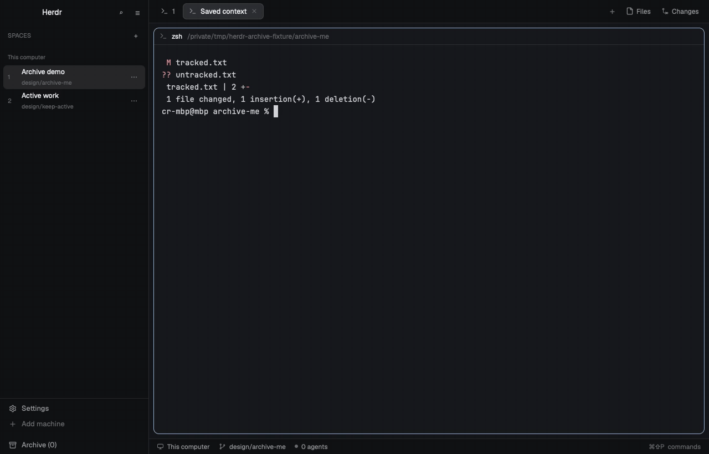

# Herdr Archive

Archive Herdr spaces without stopping their terminals or agents. Archived spaces leave everyday navigation and stay searchable in a browser where you can restore a row, a repository group, or all shown results.



The **stock** variant is the default for a new install. It uses Herdr 0.1.14's shipped mods and needs no Orca setup. The optional **Orca** variant keeps the personal Orca layout and its custom controls.

## Install

Use Python 3.10 or newer. Clone this repository, then run:

```sh
git clone https://github.com/cesartevisual/herdr-archive.git
cd herdr-archive
python3 scripts/archive.py install --dry-run
python3 scripts/archive.py install
herdr-app check ~/.config/herdr-app/mods/archive-stock
herdr-app check ~/.config/herdr-app/mods/space-archive
python3 scripts/archive.py activate
```

The stock installer checks for Herdr's shipped `tabs`, `pane`, `files`, `changes`, `workspace-status`, `workspace-chrome`, and `worktree` mods. It installs `layouts/archive-stock.json` and its SVG preview, `mods/archive-stock/`, `mods/space-archive/`, and free layout-specific bindings from `keys.stock.patch.json`.

For the Orca variant, first install [Orca for Herdr](https://github.com/VladTemp27/herdr-orca) and its [Better Changes dependency](https://github.com/munza/herdr-mods/tree/main/better-changes), then run:

```sh
python3 scripts/archive.py install --variant orca --dry-run
python3 scripts/archive.py install --variant orca
herdr-app check ~/.config/herdr-app/mods/archive-sidebar
herdr-app check ~/.config/herdr-app/mods/archive-menu
herdr-app check ~/.config/herdr-app/mods/archive-picker
herdr-app check ~/.config/herdr-app/mods/archive-chrome
herdr-app check ~/.config/herdr-app/mods/space-archive
python3 scripts/archive.py activate
```

The Orca variant requires these existing custom mods: `better-changes`, `desktop-notifications`, `files-open-with`, `hibernate`, `live-ports`, `my-pane`, `my-status`, `my-tabs`, `resources`, `sidebar-nav`, `t3-actions`, `usage-limits`, `project-settings`, `my-worktree`, and `new-worktree`. The installer checks them before copying files.

Pass `--home /path/to/profile` to any command to target another Herdr profile. `activate` switches layouts through `herdr-app do layout.switch` and records the previous layout. An existing install retains its variant on repeat `install`; a legacy manifest without a variant remains Orca. Uninstall before changing variants.

```sh
python3 scripts/archive.py status
python3 scripts/archive.py uninstall --dry-run
python3 scripts/archive.py uninstall
```

The installer never overwrites an occupied mod, layout, or key binding. It tracks installed file hashes and stops uninstall if one was edited. Uninstall switches back only when its layout is active, removes owned files and bindings, and preserves Herdr's `shared.json`. Herdr-generated editor files and user additions left in installed mod folders move to a unique `.herdr-archive-backups/uninstall-*` directory under the profile, freeing the mod names for reinstall. Archived records remain in shared state after uninstall.

## Use

Open **Space archive** from the layout's Archive control. Archive a live space from its space menu. Search by space name, folder, branch, repository, or machine; restore a row, a group, or the shown results. A remote space that is unavailable stays archived until it returns. The variants provide their own layout-specific shortcuts in `keys.stock.patch.json` and `keys.patch.json`.

Archive metadata lives under the `space-archive.v1` shared-state key. Archiving does not close, delete, or stop a space, terminal, agent, checkout, or worktree. The archive feature adds no network request. The optional Orca variant inherits mods that may run commands or access services; consult their sources and settings. Its menu uses `git` for existing worktree actions.

## Development and provenance

```sh
npm test
```

The Node tests cover archive state, search, and grouping. Python tests exercise both installer variants against temporary profiles, including collisions, repeat installs, manifest compatibility, shortcut ownership, generated-file backups, and removal after local edits. The mods use Herdr's native GPUI JavaScript API.

See [RECIPE.md](RECIPE.md) for the build brief, [THIRD_PARTY.md](THIRD_PARTY.md) for source revisions, and [NOTICE](NOTICE) for attribution. The repository code is Apache-2.0; bundled icons retain their ISC/MIT notices.

## Herdr ecosystem

This repository is tagged `herdr-layout` and `herdr-mod` for gallery discovery. It changes personal layout and mod files, not Herdr core. Report Archive bugs here; use [Herdr's contribution guide](https://github.com/herdrdev/herdr-app/blob/master/CONTRIBUTING.md) for core API requests or Herdr bugs. Pull requests should include relevant tests and native mod checks.
