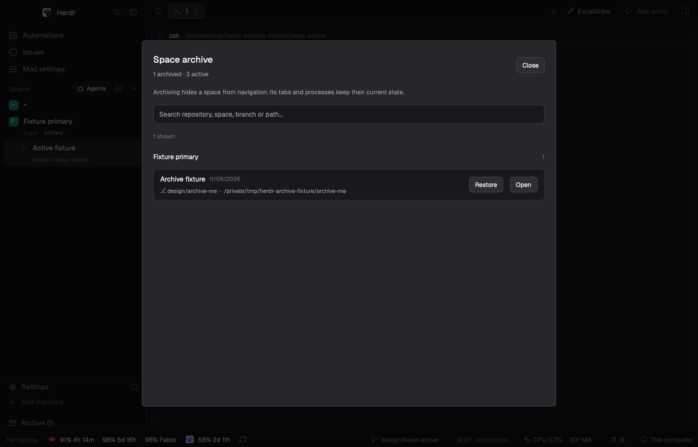

# Herdr Archive

A Herdr layout that keeps active spaces in everyday navigation and lets people archive the rest without ending their terminals or agents. The default build uses Herdr's shipped interface pieces; an optional Orca variant keeps that personal layout's controls.

## What you see

In the stock layout, a 268 px sidebar sits beside the work area. Its 46 px header has a Herdr title and search control. Below it, spaces appear under machine headings. Each row shows a number, space name, branch or folder, status color, agent count, and a ⋯ menu. Up to six active agents appear below the spaces. If every space is archived, the sidebar shows a hint to open Archive or create a space. The shipped `workspace-chrome` footer is 69 px high, followed by a visible 32 px Archive control.

The work area keeps Herdr's 42 px tab strip, active terminal panes with 30 px pane headers, a 368 px Files/Changes panel, and a 28 px status strip. The archive browser is a centered dialog with a count, search field, repository-and-machine groups, and rows showing name, branch, folder, archive date, and availability. Unavailable remote spaces say **Unavailable**. Restore actions appear on each live row, each group with multiple live rows, and all shown live results.

## How it behaves

The sidebar shows live, unarchived spaces and agents. Working, blocked, done, and idle statuses use the Herdr theme's status colors; agent rows show a colored status dot. The ⋯ menu offers Rename, New tab, Open worktree, and Archive space. Archiving stores the space's ID and display metadata under `space-archive.v1` and hides it from the sidebar and picker; it does not close a terminal, stop an agent, or delete a worktree. If the focused space is archived, another available space is selected when possible.

Search opens a picker of active spaces. Matching archived spaces appear when a query is entered; choosing one opens the Archive dialog for explicit restoration. The dialog searches name, folder, branch, repository, and machine. It can restore one row, a repository group, or the shown results, and offers Undo for its latest action. A remote space that is unavailable remains archived until the machine and space return. Stock shortcuts include `cmd-p` for the picker, `cmd-alt-[` / `cmd-alt-]` for spaces, `cmd-[` / `cmd-]` for agents, and `ctrl-1` through `ctrl-9` for visible spaces.

## Built from

`layouts/archive-stock.json` has a root row with `sidebar` and `work` columns. The sidebar places `archive-stock` in its header and spaces blocks, then shipped `workspace-chrome` and a `space-archive` controller. The work column uses shipped `tabs`, `pane`, `files`, `changes`, and `workspace-status` mods. The custom `archive-stock` mod renders the sidebar, menu, and picker. `space-archive` renders the browser and holds pure state transformations in `model.js` plus a Herdr host adapter in `state.js`. `keys.stock.patch.json` adds layout-scoped bindings. The menu opens the shipped `worktree` mod and the sidebar uses Herdr `exec("git", …)` to derive repository grouping.

The optional Orca layout is `layouts/archive.json`, with its archive-specific copies of Orca chrome, sidebar, menu, and picker and the same `space-archive` browser. Its separate `keys.patch.json` holds its layout bindings. Both variants use Herdr `shared`, `setShared`, `spaces`, `panes`, `run`, and `openOverlay`; neither edits `shared.json` directly.

## Watch out

The stock build targets Herdr app 0.1.14 and requires the shipped mods named in README. The Orca variant additionally requires its listed personal mods and should not be assumed present in a fresh profile. Never overwrite an occupied mod, layout, or key binding. Uninstall must preserve Herdr-generated editor files and user additions by moving remaining mod folders to a unique backup directory. An unavailable remote space must keep its archive record until it is live again. The copied Orca files and bundled icon notices are documented in THIRD_PARTY.md and NOTICE.

## Done when

- `npm test` passes state and both installer-variant suites.
- `herdr-app check` passes for `archive-stock` and `space-archive` in a stock profile, and for each copied Orca mod when using that variant.
- Activating the stock layout shows the sidebar, Archive control, tabs, panes, Files/Changes panel, and status strip without a layout or mod `.error` file.
- Archiving a live space hides it from the sidebar and picker while its terminal and agents keep running; search finds its record and restoring it makes it visible again.
- An unavailable remote record remains intact until the remote space returns.
- Uninstall returns to the previous layout when Archive is active, preserves archived shared state and unowned mod files, and permits reinstall.
